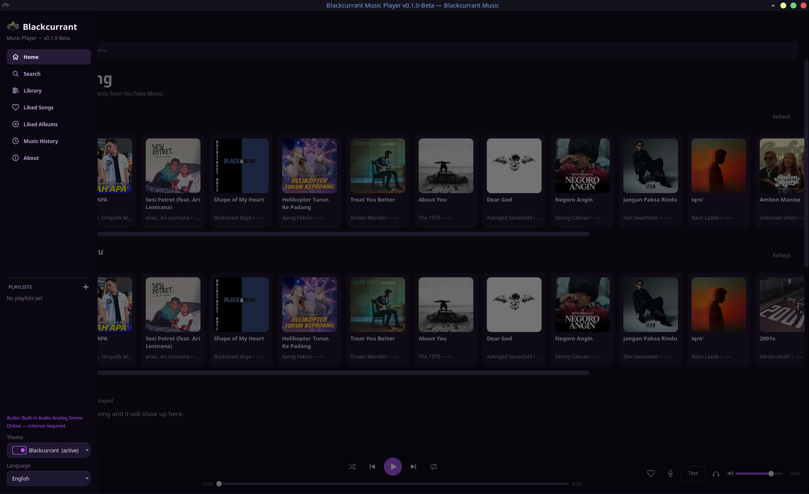
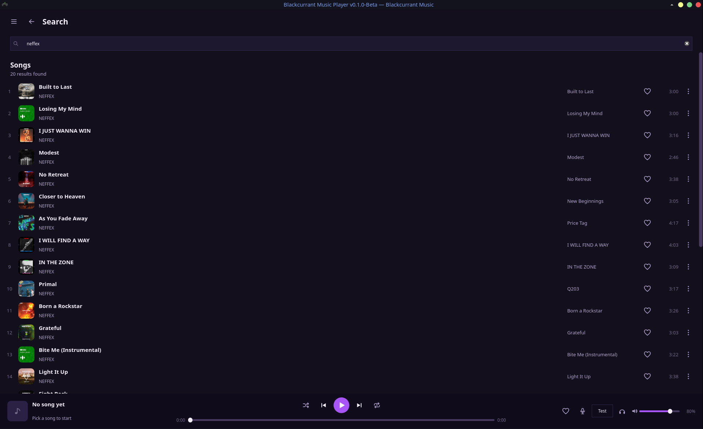
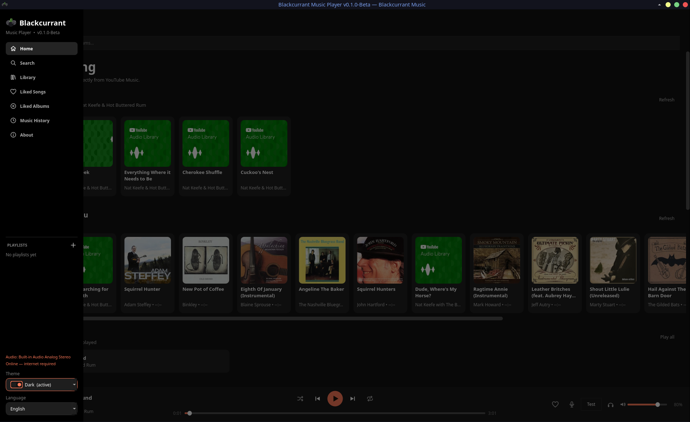
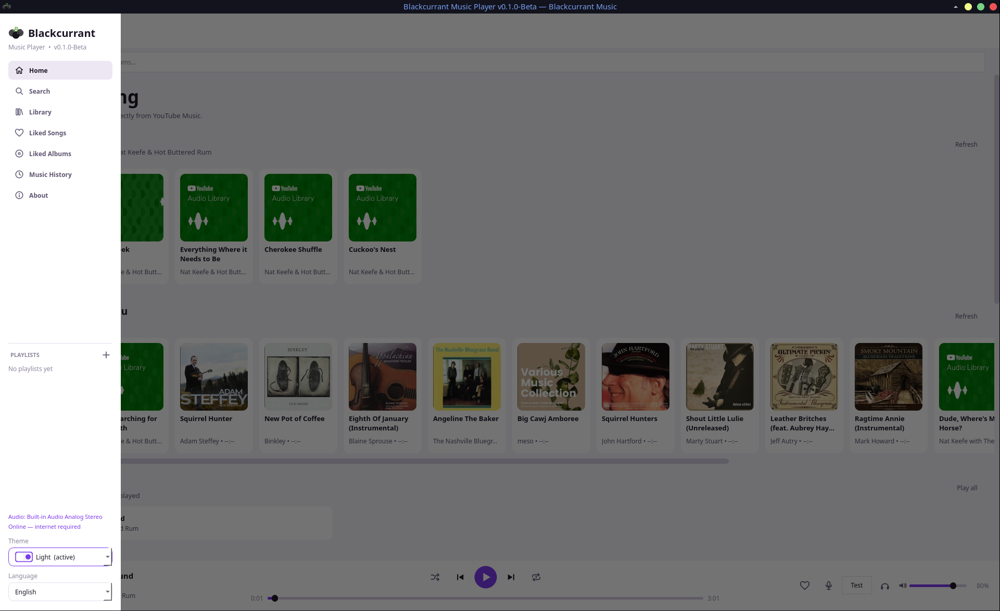

<p align="center">
  
</p>

<h1 align="center">Blackcurrant Music Player</h1>

<p align="center">
  A Streaming Music Apps desktop music player for Linux, built with Qt 6 and C++.<br>
  Browse and stream music from YouTube Music, with no account required.
</p>

<p align="center">
  <b>Version 0.1.0-Beta</b> &middot; Linux (AppImage) &middot; English / Bahasa Indonesia
</p>

---

## Screenshots

| Home | Search |
|:---:|:---:|
|  |  |

**Themes:** *Blackcurrant* (default), *Dark*, and *Light*.

| Blackcurrant | Dark | Light |
|:---:|:---:|:---:|
|  |  |  |

---

## Features

- **Home**: greeting, quick picks, personalized recommendations, albums from the YouTube Music home page, genres and moods, and a "recently played" shelf.
- **Search**: live suggestions, search history, and results for songs and albums.
- **Library**: local playlists (create, rename, delete), liked songs, liked albums, and listening history.
- **Album, playlist, genre, and artist pages**: top songs, albums and singles, and full song lists.
- **Lyrics panel** that slides in from the right for the track that is playing.
- **Player bar**: play/pause, previous/next, shuffle, repeat one, seek, like, volume (remembered), audio output device picker, and a sound test.
- **Three themes** and a **bilingual interface** (English and Bahasa Indonesia) that switch instantly, without a restart.
- **Taste-aware recommendations** learned locally from what you play. Your data never leaves your machine.
- **Keyboard shortcuts**: `Space` to play/pause, `Esc` to go back.

---

## Install (Linux AppImage)

The AppImage is a single self-contained file. It bundles Qt 6, the multimedia plugins, a portable Python runtime, and `yt-dlp`, so you do not need to install anything else besides your system's FUSE 2 library (see step 2).

### 1. Download

Get the latest file from the **[Releases page](https://github.com/<OWNER>/<REPO>/releases)**:

```
Blackcurrant_Music_Player-0.1.0-Beta-x86_64.AppImage
Blackcurrant_Music_Player-0.1.0-Beta-x86_64.AppImage.sha256
```

Optional: verify the download.

```bash
sha256sum -c Blackcurrant_Music_Player-0.1.0-Beta-x86_64.AppImage.sha256
```

### 2. Make sure FUSE 2 is installed

AppImages need the FUSE 2 library. Many desktop distributions already ship it. If the app refuses to start with a message about `libfuse.so.2`, install it:

| Distribution | Command |
|---|---|
| Ubuntu 22.04 / Debian / Linux Mint | `sudo apt install libfuse2` |
| Ubuntu 24.04 and newer | `sudo apt install libfuse2t64` |
| Fedora | `sudo dnf install fuse-libs` |
| Arch / Manjaro | `sudo pacman -S fuse2` |
| openSUSE | `sudo zypper install libfuse2` |

No root access, or you do not want FUSE? Skip this step and run the AppImage with `--appimage-extract-and-run` (see below).

### 3. Run it

```bash
chmod +x Blackcurrant_Music_Player-0.1.0-Beta-x86_64.AppImage
./Blackcurrant_Music_Player-0.1.0-Beta-x86_64.AppImage
```

You can also right-click the file in your file manager, open **Properties**, and enable **Allow executing file as program**, then double-click it.

Without FUSE:

```bash
./Blackcurrant_Music_Player-0.1.0-Beta-x86_64.AppImage --appimage-extract-and-run
```

### 4. (Optional) Add it to your application menu

The simplest way is [AppImageLauncher](https://github.com/TheAssassin/AppImageLauncher), which offers to integrate any AppImage you open.

Or do it by hand (no extra software needed):

```bash
APPIMAGE=Blackcurrant_Music_Player-0.1.0-Beta-x86_64.AppImage

mkdir -p ~/Applications ~/.local/share/icons ~/.local/share/applications
mv "$APPIMAGE" ~/Applications/

# Extract the icon from inside the AppImage
cd /tmp
~/Applications/"$APPIMAGE" --appimage-extract usr/share/icons/hicolor/512x512/apps/blackcurrant.png
cp squashfs-root/usr/share/icons/hicolor/512x512/apps/blackcurrant.png ~/.local/share/icons/blackcurrant.png
rm -rf squashfs-root

# Create the launcher entry
cat > ~/.local/share/applications/blackcurrant.desktop <<EOF
[Desktop Entry]
Type=Application
Name=Blackcurrant Music Player
Comment=Open-source desktop music player using YouTube Music as its data source
Exec=$HOME/Applications/$APPIMAGE
Icon=$HOME/.local/share/icons/blackcurrant.png
Categories=AudioVideo;Audio;Player;
Terminal=false
EOF

update-desktop-database ~/.local/share/applications 2>/dev/null || true
```

"Blackcurrant Music Player" should now appear in your application menu.

### Update

Download the new AppImage, replace the old file, and run it. Your playlists, likes, and settings are stored separately (see [Your data](#your-data)), so they are kept.

### Uninstall

```bash
rm -f ~/Applications/Blackcurrant_Music_Player-*.AppImage
rm -f ~/.local/share/applications/blackcurrant.desktop ~/.local/share/icons/blackcurrant.png
# Also remove your playlists, likes, history, and settings (optional):
rm -rf ~/.config/blackcurrant-music-player
```

---

## Requirements

- A 64-bit Linux desktop (X11 or Wayland) with a reasonably recent glibc. Very old distributions may not start the AppImage.
- FUSE 2 (see step 2), or use `--appimage-extract-and-run`.
- A working audio output (PulseAudio or PipeWire).
- An **internet connection**. Music is streamed from YouTube Music; there is no offline playback in this version.

---

## Your data

Everything is stored locally in `~/.config/blackcurrant-music-player/` (it follows `XDG_CONFIG_HOME`):

`playlists.json`, `liked.json`, `liked_albums.json`, `history.json`, `playcounts.json`, `taste.json`, `search_history.json`, `settings.json`, and a `cache/` folder for thumbnails.

No account or sign-in is used.

### Automatic yt-dlp updates

YouTube changes often, so the app keeps its bundled `yt-dlp` fresh. On first run it copies `yt-dlp` to `~/.config/blackcurrant-music-player/bin/` and updates that copy in the background (at most once a day). If every YouTube client fails to fetch a stream, it also updates once and retries automatically. If you point the app to your own `yt-dlp` with `BC_YTDLP`, it will not touch it.

---

## Troubleshooting

| Problem | What to try |
|---|---|
| `dlopen(): error loading libfuse.so.2` | Install FUSE 2 (step 2), or run with `--appimage-extract-and-run`. |
| Nothing happens when double-clicking | Make the file executable (step 3). Run it from a terminal to see error messages. |
| A song will not play / "stream not found" | Check your internet connection and wait a few seconds: `yt-dlp` may be updating itself. Then try the song again. |
| No sound | Open the audio device picker in the player bar and choose your output, then use **Test sound**. Also check your system volume and PipeWire/PulseAudio settings. |
| Window does not appear on Wayland | Start with `QT_QPA_PLATFORM=xcb ./Blackcurrant_Music_Player-0.1.0-Beta-x86_64.AppImage`. |
| Interface language is wrong | Use the **Language** selector at the bottom of the sidebar (below the Theme selector). |

### Environment variables

| Variable | Purpose |
|---|---|
| `BC_YTDLP` | Path to a custom `yt-dlp` binary. |
| `BC_PYTHON` | Python interpreter used for the data bridge. |
| `BC_DATA_DIR` | Use a different folder for your data. |

---

## How it works

```
Qt 6 / C++ UI + audio (QMediaPlayer, FFmpeg backend)
        |  JSON lines over stdin/stdout
Python bridge (ytmusicapi)  ->  YouTube Music data
        |
yt-dlp  ->  audio stream URL
```

The whole interface and audio playback run natively in C++/Qt, which keeps scrolling and startup fast. A small long-running Python process fetches search results, albums, artists, and lyrics through [`ytmusicapi`](https://github.com/sigma67/ytmusicapi), and [`yt-dlp`](https://github.com/yt-dlp/yt-dlp) resolves the audio stream for the track you play.

---

## Build from source

Requires Qt 6.5+ (Widgets, Network, Multimedia), CMake 3.16+, a C++17 compiler, Python 3 with `ytmusicapi`, and `yt-dlp` in your `PATH`.

```bash
git clone https://github.com/<OWNER>/<REPO>.git
cd <REPO>/music_player_qt
pip install -r bridge/requirements.txt
cmake -S . -B build -G Ninja -DCMAKE_BUILD_TYPE=Release
ninja -C build
./build/blackcurrant
```

To build the AppImage yourself:

```bash
./build-appimage.sh --install-qt                     # downloads Qt 6.7.3, then builds
QT_DIR=$HOME/Qt/6.7.3/gcc_64 ./build-appimage.sh     # or use your own Qt (6.5+)
```

The result is written to `dist/`. For best compatibility, build on the oldest distribution you want to support.

---

## Disclaimer

Blackcurrant Music Player is an independent, open-source project. It is **not affiliated with, endorsed by, or sponsored by YouTube, YouTube Music, or Google**. It relies on unofficial third-party tools (`ytmusicapi` and `yt-dlp`) to access public data and streams. You are responsible for using it in line with the terms of service of the services you access and the laws that apply to you. All trademarks belong to their respective owners.

This is a **beta release**: expect rough edges, and please report bugs.

---

## Credits

- **Developer:** Opensource OS Gathering Republic (OOGR)
- **Maintainer:** Didi Sloth Stanca
- Built with [Qt](https://www.qt.io/), [ytmusicapi](https://github.com/sigma67/ytmusicapi), [yt-dlp](https://github.com/yt-dlp/yt-dlp), and FFmpeg.

## License

This project is licensed under the **GNU General Public License v3.0 or later** (GPL-3.0-or-later). See the [LICENSE](LICENSE) file for details.
